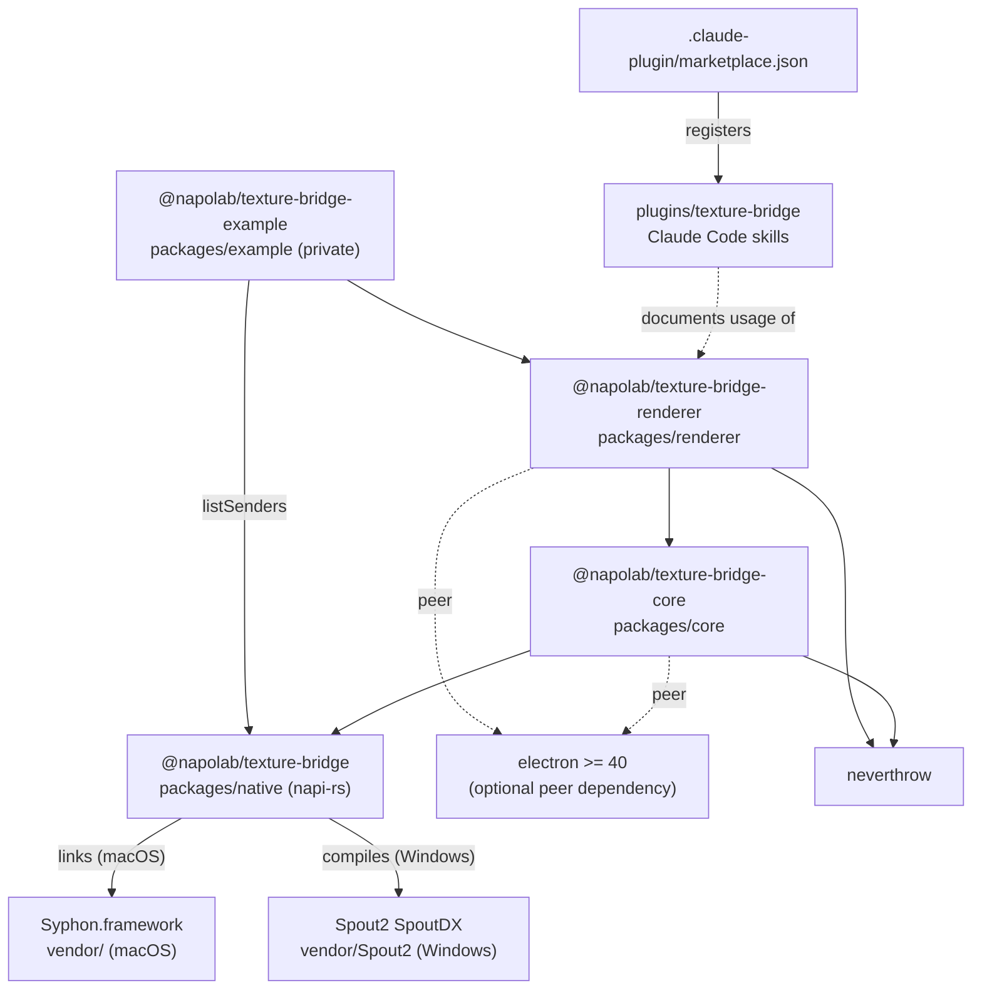
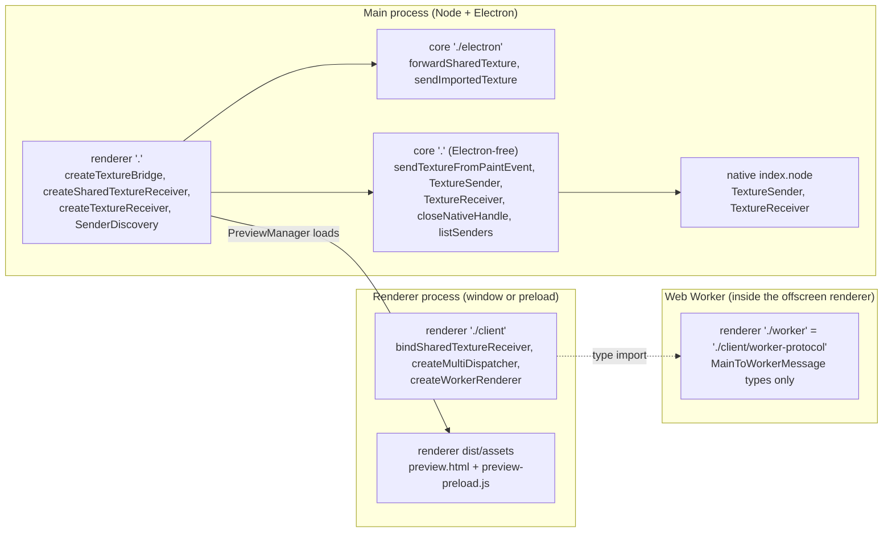
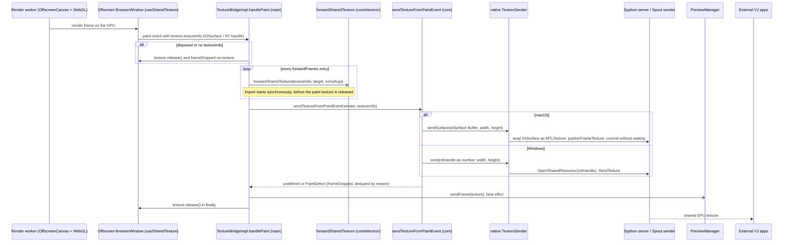
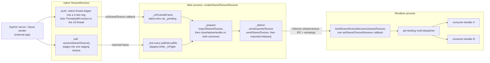
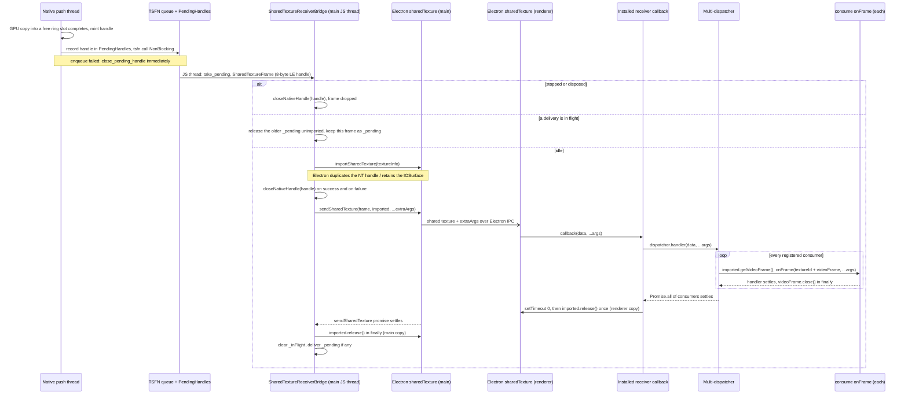
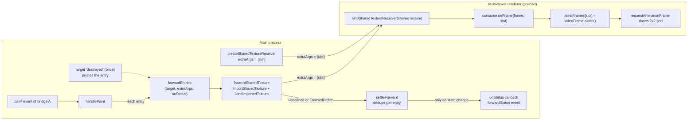
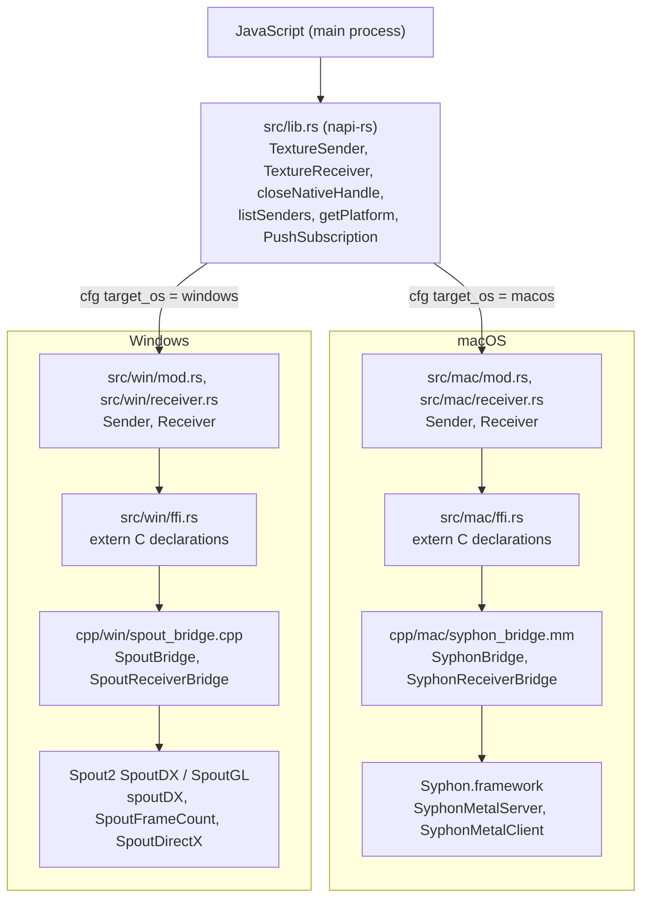
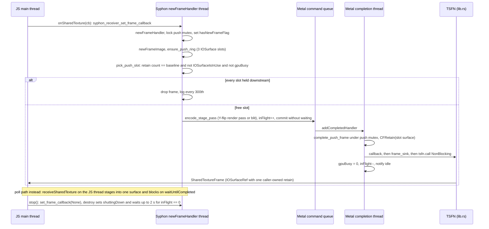
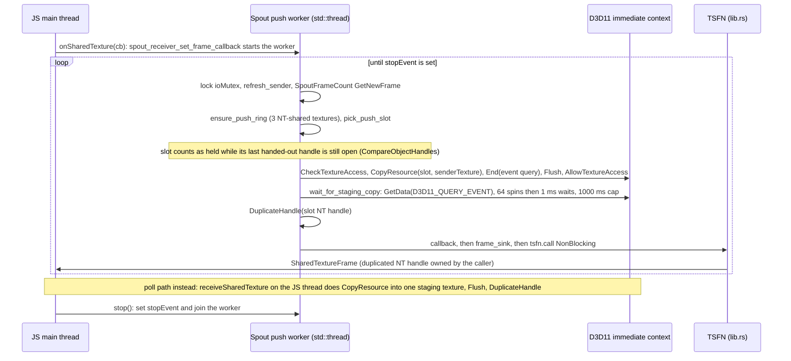

# Architecture

This page maps the current architecture of electron-texture-bridge with diagrams: how the packages depend on each other, which process each entry runs in, how a frame travels on the send and receive paths, and how the native addon is layered and threaded. Every node in the diagrams corresponds to code in this repository; the source files are listed under each diagram.

For the user-facing API see [API Reference](API.md). For the receive-side ownership contract in prose see [Receiving](RECEIVING.md).

- [1. Packages and processes](#1-packages-and-processes)
- [2. Send path](#2-send-path)
- [3. Receive path and frame forwarding](#3-receive-path-and-frame-forwarding)
- [4. Native addon layers and threads](#4-native-addon-layers-and-threads)

## 1. Packages and processes

### 1.1 Package dependencies

The three published packages form a straight chain: `renderer` → `core` → `native`. The example app imports `renderer` for everything except `listSenders`, which it takes straight from `native`. Electron is an optional peer dependency of `core` and `renderer`, so the core main entry can be loaded from plain Node. The Claude Code plugin has no runtime relationship with the packages; it only ships skills that describe how to use them, and the repository root marketplace registers it.

Source files:
- `packages/native/package.json`, `packages/core/package.json`, `packages/renderer/package.json`, `packages/example/package.json`
- `packages/native/build.rs`
- `plugins/texture-bridge/.claude-plugin/plugin.json`, `.claude-plugin/marketplace.json`, `plugins/texture-bridge/skills/`

### 1.2 Entry points by process

`renderer`'s `.` entry and both `core` entries run in the main process. `core`'s `.` entry must stay importable without Electron (enforced by `scripts/electron-free-guard.mjs`), so everything that touches `electron.sharedTexture` lives in the `./electron` subpath. `renderer/client` runs in a renderer or preload and never imports `core` or `native`. `./worker` and `./client/worker-protocol` are the same module and contain only message types for the main-thread ↔ worker protocol. The preview window loads its own preload and HTML from `renderer`'s `dist/assets`.

Source files:
- `packages/renderer/package.json` (`exports`), `packages/renderer/tsdown.config.mts`
- `packages/core/package.json` (`exports`), `packages/core/scripts/electron-free-guard.mjs`
- `packages/renderer/src/index.ts`, `packages/renderer/src/client/index.ts`, `packages/renderer/src/client/worker-protocol.ts`
- `packages/core/src/index.ts`, `packages/core/src/electron.ts`
- `packages/renderer/src/preview-manager.ts`, `packages/renderer/src/assets/preview-preload.js`

## 2. Send path

The page renders in a Web Worker on an `OffscreenCanvas`. The library helper `createWorkerRenderer` does the canvas transfer, but the example's `index.html` calls `transferControlToOffscreen()` itself. Each Chromium paint hands the main process a GPU handle. `handlePaint` first starts every `forwardFrames` forward, then hands the handle to the native sender, then to the preview, and releases the paint texture in `finally`. Pixels are never read back to the CPU: on macOS the IOSurface is wrapped as an `MTLTexture` and published through `SyphonMetalServer`; on Windows the NT handle is opened with `OpenSharedResource1` and passed to `spoutDX::SendTexture`. Each SDK then does its own GPU-side copy into the shared surface it publishes. The send path has **no** in-flight or drop-latest logic: every paint is sent synchronously, and the only thing deduplicated is the `frameDropped` event (consecutive drops with the same reason are reported once).

Source files:
- `packages/renderer/src/bridge.ts` (`handlePaint`, `buildBrowserWindowOptions`, `createTextureBridgeWith`)
- `packages/renderer/src/client/index.ts` (`createWorkerRenderer`), `packages/example/src/renderer/index.html`, `packages/example/src/renderer/render-worker.ts`
- `packages/core/src/index.ts` (`sendTextureFromPaintEvent`), `packages/core/src/electron.ts` (`forwardSharedTexture`)
- `packages/renderer/src/preview-manager.ts`
- `packages/native/src/lib.rs` (`TextureSender`), `packages/native/src/mac/mod.rs`, `packages/native/src/win/mod.rs`
- `packages/native/cpp/mac/syphon_bridge.mm` (`syphon_bridge_send_surface`), `packages/native/cpp/win/spout_bridge.cpp` (`spout_bridge_send`)

## 3. Receive path and frame forwarding

### 3.1 Overview: push and poll

`createSharedTextureReceiver` uses push mode by default on macOS and Windows: the native side calls back as soon as a frame is staged on the GPU. If subscribing fails it emits the error and falls back to poll mode, where a `setInterval` calls `receiveSharedTexture()`. Both modes funnel into the same `_deliverFrame` → `_prepare` → `_deliver` pipeline. Only one delivery is in flight at a time: in poll mode ticks are skipped while `_inFlight` is set, and in push mode only the newest frame is kept as `_pending`. In the renderer, one binding owns Electron's single receiver slot and fans each frame out to every registered `consume` handler.

Source files:
- `packages/renderer/src/shared-texture-receiver.ts`
- `packages/renderer/src/client/shared-texture-consumer.ts`, `packages/renderer/src/client/multi-dispatcher.ts`
- `packages/core/src/electron.ts` (`sendImportedTexture`)
- `packages/native/src/lib.rs` (`TextureReceiver.onSharedTexture`, `receiveSharedTexture`)

### 3.2 One frame's lifetime and handle ownership (push mode)

Three separate references are owned and released on separate paths. (1) The **native handle** minted per frame (NT handle / retained `IOSurfaceRef`) is closed exactly once with `closeNativeHandle`: right after the import attempt whatever the outcome (`andTee` / `orTee` in `_prepare`), or without importing when the frame is superseded, arrives after `stop()`, or its target is destroyed. Frames still queued on the TSFN when the subscription is dropped are closed natively. (2) The **main-side imported texture** is released in `sendImportedTexture`'s `finally` after `sendSharedTexture` settles. When that promise settles relative to the renderer's work is up to Electron. (3) The **renderer-side imported texture** is released once by the installed callback, on the next task after every consumer's `onFrame` has settled. Each consumer gets its own `VideoFrame`, which it closes after its handler settles. If no consumers are registered, or the binding was disposed, the callback still drains and releases frames.

Source files:
- `packages/native/src/lib.rs` (`PushSubscription`, `PendingHandles`, `detach_push`, `close_native_handle`)
- `packages/renderer/src/shared-texture-receiver.ts` (`_onPushedFrame`, `_deliverFrame`, `_prepare`, `_deliver`, `releaseNativeHandle`)
- `packages/core/src/electron.ts` (`sendImportedTexture`)
- `packages/renderer/src/client/shared-texture-consumer.ts` (`installReceiver`, `registerConsumer`)
- `packages/renderer/src/client/multi-dispatcher.ts`

### 3.3 forwardFrames fan-out and the multiviewer

`TextureBridge.forwardFrames(target, { extraArgs, onStatus })` adds an entry, and every paint forwards the same paint handle to each entry's `WebContents` through `forwardSharedTexture`. This is zero-copy because only a GPU handle crosses processes. Each frame's result goes through `settleForward`, which reports only state changes (first success, a new failure reason, recovery) to `onStatus` and the bridge's `forwardStatus` event. An entry is removed by `dispose()`, by the target's `destroyed` event, or by `bridge.dispose()`. The example multiviewer feeds four slots into one window: local sources via `forwardFrames` and Syphon/Spout sources via `createSharedTextureReceiver`, both tagged with `extraArgs: [slot]`. Its preload reads `args[0]` to route each frame and clones the `VideoFrame` so it can outlive the handler.

Source files:
- `packages/renderer/src/bridge.ts` (`forwardFrames`, `settleForward`, `toForwardStatus`, `unhookDestroyedListener`)
- `packages/renderer/src/types.ts` (`FrameForwardOptions`, `FrameForward`, `ForwardStatus`)
- `packages/core/src/electron.ts` (`forwardSharedTexture`, `ForwardDefect`)
- `packages/example/src/main/index.ts` (`multi-connect` handler), `packages/example/src/preload/multiviewer.ts`

### 3.4 forwardPreviewFrames (native downscaled thumbnails)

`TextureBridge.forwardPreviewFrames(target, { width, height, extraArgs, onStatus })` registers into a separate entry set and turns on one native preview tap per bridge (`TextureSender.setPreview`, bounds of the oldest registration; off again when the last entry goes). The tap rides on the send:

- **macOS** (`syphon_bridge.mm`): `publish_and_commit` encodes, after `publishFrameTexture` on the *same* command buffer, a fullscreen-triangle box-filter pass into a private RGBA8 target (sized to fit the bounds) and a blit into a Shared `MTLBuffer` of a 3-slot ring. The publish completion handler copies the bytes out (Metal completion thread) and frees the slot before decrementing the in-flight count, so `syphon_bridge_destroy`'s drain also covers preview delivery. The source is the cached `MTLTexture` wrapper (IOSurface → wrapper cache, ≤16 entries, CFRetained keys, flushed on size/format change and on destroy), so the tap adds no IOSurface wrap.
- **Windows** (`spout_bridge.cpp`): after `SendTexture`, `CopySubresourceRegion` into mip 0 of a full-resolution mip-chain texture, `GenerateMips`, copy the covering mip level into a staging ring slot, `Flush`. The next `send` maps pending slots with `D3D11_MAP_FLAG_DO_NOT_WAIT` (never stalls) and delivers the newest completed one. D3D11 has no completion callback, so a sender that stops sending would otherwise never deliver its last frame: `TextureSender.pollPreview()` (`spout_bridge_poll_preview`) runs the same non-blocking map without a send, and `handlePaint` arms a one-shot ~8 ms timer after each send while the tap is on, re-arming only while `pollPreview()` reports a pending readback. On macOS the bridge never arms it (`getPlatform() !== "spout"`) and `pollPreview()` is a no-op.

`lib.rs` copies the bytes into a `Vec<u8>` and queues it on an unref'd ThreadsafeFunction (queue bound 2 — a stalled JS thread drops previews). That is two CPU copies per delivered preview: readback → `Vec` (the slot is reused right away), and `Vec` → JS `Buffer`, because Electron forbids external buffers and napi-rs falls back to `napi_create_buffer_copy`. The TSFN calls a Rust dispatcher bound to the user callback; replacing or removing the tap flags the old TSFN as detached and *releases* it (never aborts: Node hands an aborted TSFN's leftover queue to `call_js_cb` with a null env, and napi-rs 2 returns there without freeing the payload), so queued stale frames are still dispatched and freed but skip the callback. On the JS thread the bridge sends `{ width, height, data }` plus `extraArgs` to every target with `webContents.send(PREVIEW_FRAME_CHANNEL, ...)` and settles the same `forwardStatus` transitions (`preview-unavailable` when `setPreview` throws). The renderer side is `consumePreviewFrames(ipcRenderer)`.

Source files:
- `packages/native/cpp/mac/syphon_bridge.mm` (`reserve_preview_slot`, `encode_preview`, `deliver_preview`, `wrap_surface_cached`)
- `packages/native/cpp/win/spout_bridge.cpp` (`encode_preview`, `poll_preview`, `spout_bridge_poll_preview`)
- `packages/native/src/lib.rs` (`TextureSender::set_preview`, `TextureSender::poll_preview`, `create_preview_sink`, `PreviewTap`)
- `packages/renderer/src/bridge.ts` (`forwardPreviewFrames`, `applyPreviewTap`, `handlePreviewFrame`, `schedulePreviewPoll`)
- `packages/renderer/src/client/preview-frame-consumer.ts`, `packages/renderer/src/client/preview-protocol.ts`

## 4. Native addon layers and threads

### 4.1 Layers

`lib.rs` is the only napi-rs surface. It selects the platform module with `#[cfg(target_os)]` and holds the platform-neutral push machinery (`PushSubscription`, `PendingHandles`). Each platform module wraps the raw C handles in RAII types (`Drop` calls the matching `*_destroy`) and declares the C ABI in `ffi.rs`. The C++/ObjC++ bridges talk to the vendor SDKs. On the sender side Windows uses the `spoutDX` helper, while the receiver talks to `SpoutSenderNames` / `SpoutFrameCount` / `SpoutDirectX` directly. `build.rs` resolves `vendor/` relative to the workspace root.

Source files:
- `packages/native/src/lib.rs`, `packages/native/src/types.rs`
- `packages/native/src/mac/mod.rs`, `packages/native/src/mac/receiver.rs`, `packages/native/src/mac/ffi.rs`
- `packages/native/src/win/mod.rs`, `packages/native/src/win/receiver.rs`, `packages/native/src/win/ffi.rs`
- `packages/native/cpp/mac/syphon_bridge.mm`, `packages/native/cpp/mac/syphon_bridge.h`, `packages/native/cpp/win/spout_bridge.cpp`
- `packages/native/build.rs`

### 4.2 macOS receive threads

Push mode on macOS does not create a thread of its own. Syphon calls `newFrameHandler` on its own background thread, which picks a free slot from a 3-surface ring and encodes a GPU staging pass (a Y-flip render pass when `flipY` is on, otherwise a blit), then commits without waiting. The Metal completion handler mints one `CFRetain` for the caller and pushes the frame through the TSFN. A slot is reused only when its retain count is back to the ring's own baseline, `IOSurfaceIsInUse` says nobody is using it, and the GPU is not writing it. Because Electron's import does not show up in the retain count, `IOSurfaceIsInUse` is what protects a slot the renderer is still sampling. Poll mode stages into a single per-receiver surface and blocks the JS thread on `waitUntilCompleted`.

Source files:
- `packages/native/cpp/mac/syphon_bridge.mm` (`syphon_receiver_create`, `stage_push_frame`, `pick_push_slot`, `complete_push_frame`, `encode_stage_pass`, `syphon_receiver_destroy`, `syphon_receiver_receive_shared_iosurface`)
- `packages/native/src/mac/receiver.rs` (`frame_callback_trampoline`, `set_frame_callback`)
- `packages/native/src/lib.rs` (`PushSubscription::frame_sink`)

### 4.3 Windows receive threads

On Windows each push subscription owns one `std::thread`. It polls Spout's frame counter about every millisecond (or every 16 ms when the sender does not count frames), copies the new frame GPU→GPU into a free slot of a 3-texture NT-shared ring, and waits for the copy on the GPU with a D3D11 event query, so the JS thread never blocks. It then hands a freshly duplicated NT handle to the TSFN. The "held" check uses `CompareObjectHandles` against the last handle handed out. The bridge closes that handle right after import, and Electron keeps its own duplicate, so in practice the ring round-robins over its 3 slots and cannot see a slot the renderer still holds. On Windows older than 10 1607, which has no `CompareObjectHandles`, a slot is treated as held forever after use. Unsubscribe and destroy signal the stop event and join the worker on the JS thread.

Source files:
- `packages/native/cpp/win/spout_bridge.cpp` (`run_push_worker`, `stage_push_frame`, `wait_for_staging_copy`, `deliver_push_frame`, `ring_slot_is_held`, `stop_push_worker`, `spout_receiver_receive_shared_texture`)
- `packages/native/src/win/receiver.rs` (`frame_callback_trampoline`, `set_frame_callback`)
- `packages/native/src/lib.rs` (`PushSubscription::frame_sink`)
