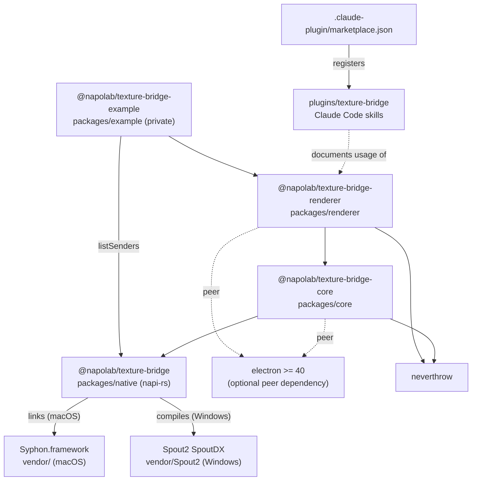
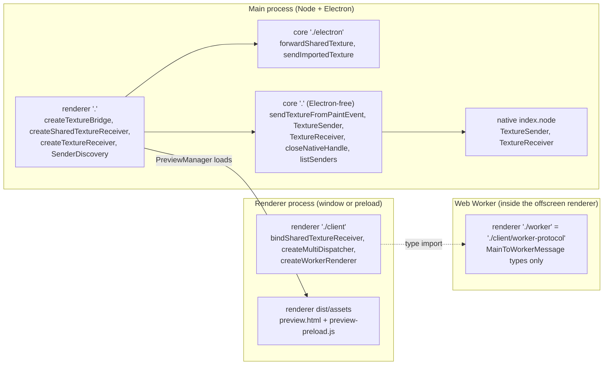
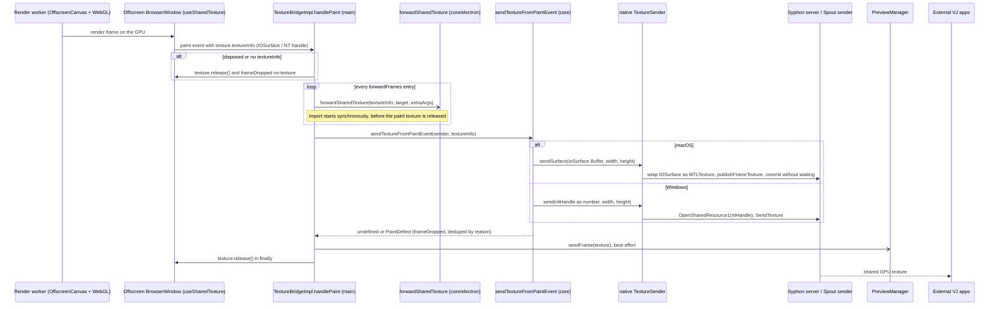
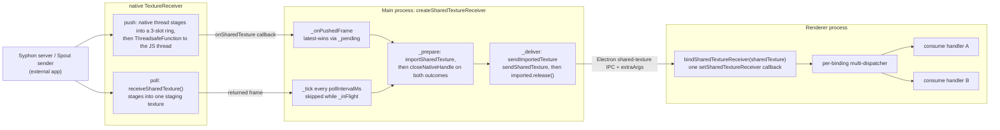
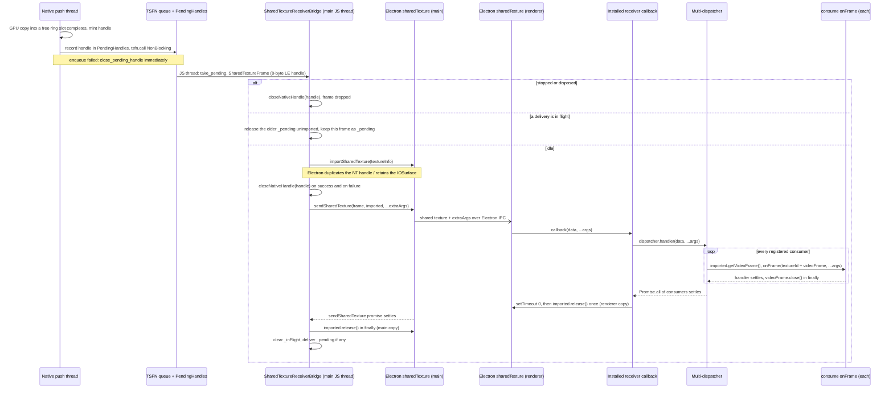
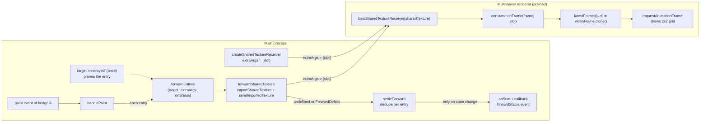
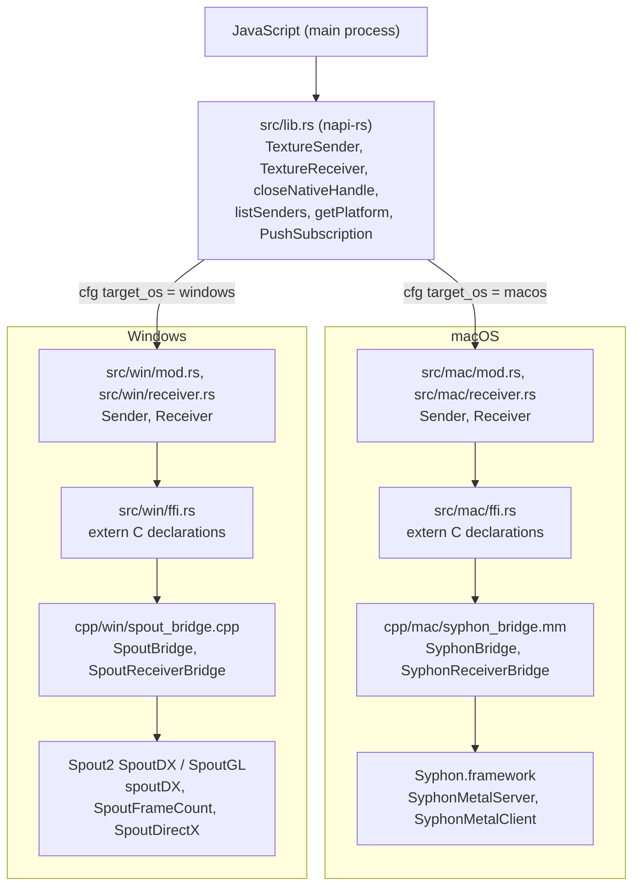
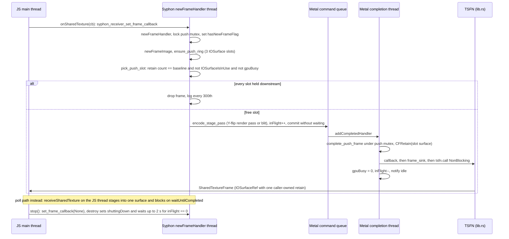
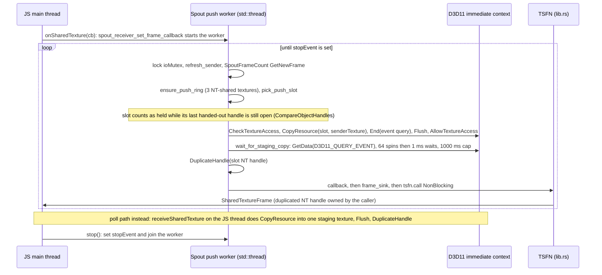

# アーキテクチャ

electron-texture-bridge の現在のアーキテクチャを図で示します。パッケージ同士の依存関係、各エントリがどのプロセスで動くか、送信経路と受信経路をフレームがどう流れるか、ネイティブアドオンのレイヤー構成とスレッドを扱います。図のノードはすべてこのリポジトリのコードに対応しており、各図の下に参照元のソースファイルを挙げています。

利用者向けの API は [API リファレンス](API.md)、受信側の所有権契約の文章による説明は [受信](RECEIVING.md) を参照してください。

- [1. パッケージとプロセス](#1-パッケージとプロセス)
- [2. 送信経路](#2-送信経路)
- [3. 受信経路とフレーム転送](#3-受信経路とフレーム転送)
- [4. ネイティブアドオンのレイヤーとスレッド](#4-ネイティブアドオンのレイヤーとスレッド)

## 1. パッケージとプロセス

### 1.1 パッケージの依存関係

公開されている 3 パッケージは `renderer` → `core` → `native` の一直線の依存になっています。example アプリは基本的に `renderer` を使い、`listSenders` だけは `native` から直接 import しています。Electron は `core` と `renderer` の optional な peer dependency なので、core のメインエントリは素の Node からも読み込めます。Claude Code プラグインはパッケージと実行時の関係を持たず、使い方を説明するスキルを配布するだけです。リポジトリルートの marketplace がプラグインを登録しています。

ソースファイル:
- `packages/native/package.json`, `packages/core/package.json`, `packages/renderer/package.json`, `packages/example/package.json`
- `packages/native/build.rs`
- `plugins/texture-bridge/.claude-plugin/plugin.json`, `.claude-plugin/marketplace.json`, `plugins/texture-bridge/skills/`

### 1.2 プロセスごとのエントリポイント

`renderer` の `.` エントリと `core` の 2 つのエントリはメインプロセスで動きます。`core` の `.` エントリは Electron なしで import できる状態を保つ必要があり（`scripts/electron-free-guard.mjs` がビルド時に検査します）、`electron.sharedTexture` に触れる処理はすべて `./electron` サブパスに置かれています。`renderer/client` はレンダラーまたは preload で動き、`core` や `native` は import しません。`./worker` と `./client/worker-protocol` は同じモジュールで、メインスレッドとワーカー間のメッセージ型だけを含みます。プレビューウィンドウは `renderer` の `dist/assets` にある専用の preload と HTML を読み込みます。

ソースファイル:
- `packages/renderer/package.json`（`exports`）, `packages/renderer/tsdown.config.mts`
- `packages/core/package.json`（`exports`）, `packages/core/scripts/electron-free-guard.mjs`
- `packages/renderer/src/index.ts`, `packages/renderer/src/client/index.ts`, `packages/renderer/src/client/worker-protocol.ts`
- `packages/core/src/index.ts`, `packages/core/src/electron.ts`
- `packages/renderer/src/preview-manager.ts`, `packages/renderer/src/assets/preview-preload.js`

## 2. 送信経路

ページは Web Worker 内の `OffscreenCanvas` で描画されます。キャンバスの受け渡しにはライブラリのヘルパー `createWorkerRenderer` が使えますが、example の `index.html` は `transferControlToOffscreen()` を自前で呼んでいます。Chromium が paint するたびに、メインプロセスへ GPU ハンドルが届きます。`handlePaint` はまず登録済みの `forwardFrames` の転送をすべて開始し、次にネイティブ送信、続いてプレビューへハンドルを渡し、最後に `finally` で paint テクスチャを解放します。ピクセルが CPU に読み戻されることはありません。macOS では IOSurface を `MTLTexture` としてラップして `SyphonMetalServer` から公開し、Windows では NT ハンドルを `OpenSharedResource1` で開いて `spoutDX::SendTexture` に渡します。その先は各 SDK が、自身の公開する共有サーフェスへ GPU 上でコピーします。送信経路には in-flight 管理や drop-latest の仕組みは**ありません**。paint ごとに同期的に送信し、重複を抑えているのは `frameDropped` イベントだけです（同じ理由のドロップが続く場合は 1 回だけ通知します）。

ソースファイル:
- `packages/renderer/src/bridge.ts`（`handlePaint`, `buildBrowserWindowOptions`, `createTextureBridgeWith`）
- `packages/renderer/src/client/index.ts`（`createWorkerRenderer`）, `packages/example/src/renderer/index.html`, `packages/example/src/renderer/render-worker.ts`
- `packages/core/src/index.ts`（`sendTextureFromPaintEvent`）, `packages/core/src/electron.ts`（`forwardSharedTexture`）
- `packages/renderer/src/preview-manager.ts`
- `packages/native/src/lib.rs`（`TextureSender`）, `packages/native/src/mac/mod.rs`, `packages/native/src/win/mod.rs`
- `packages/native/cpp/mac/syphon_bridge.mm`（`syphon_bridge_send_surface`）, `packages/native/cpp/win/spout_bridge.cpp`（`spout_bridge_send`）

## 3. 受信経路とフレーム転送

### 3.1 全体像: push と poll

`createSharedTextureReceiver` は macOS と Windows では push モードがデフォルトで、ネイティブ側が GPU 上でフレームのステージングを終えた時点でコールバックします。購読に失敗した場合はエラーを emit したうえで poll モードにフォールバックし、`setInterval` で `receiveSharedTexture()` を呼びます。どちらのモードも同じ `_deliverFrame` → `_prepare` → `_deliver` のパイプラインに合流します。同時に進む配信は常に 1 つだけです。poll モードでは `_inFlight` が立っている間の tick を捨て、push モードでは最新のフレームだけを `_pending` として保持します。レンダラー側では 1 つのバインディングが Electron の唯一のレシーバースロットを占有し、各フレームを登録済みのすべての `consume` ハンドラーへ配ります。

ソースファイル:
- `packages/renderer/src/shared-texture-receiver.ts`
- `packages/renderer/src/client/shared-texture-consumer.ts`, `packages/renderer/src/client/multi-dispatcher.ts`
- `packages/core/src/electron.ts`（`sendImportedTexture`）
- `packages/native/src/lib.rs`（`TextureReceiver.onSharedTexture`, `receiveSharedTexture`）

### 3.2 1 フレームのライフタイムとハンドルの所有権（push モード）

3 種類の参照が、それぞれ別の経路で所有・解放されます。(1) フレームごとに発行される**ネイティブハンドル**（NT ハンドル / retain 済みの `IOSurfaceRef`）は `closeNativeHandle` でちょうど 1 回閉じます。import を試みた直後に結果を問わず閉じるか（`_prepare` の `andTee` / `orTee`）、後続フレームに置き換えられたとき、`stop()` 後に届いたとき、ターゲットが破棄済みのときは import せずに閉じます。購読を解除した時点で TSFN に残っているフレームはネイティブ側で閉じます。(2) **メイン側の imported テクスチャ**は、`sendSharedTexture` が settle した後に `sendImportedTexture` の `finally` で解放します。この promise がレンダラー側の処理に対していつ settle するかは Electron の実装次第です。(3) **レンダラー側の imported テクスチャ**は、すべてのコンシューマーの `onFrame` が settle した次のタスクで、インストール済みのコールバックが 1 回だけ解放します。コンシューマーはそれぞれ専用の `VideoFrame` を受け取り、ハンドラーが settle した後に close されます。コンシューマーが 1 つも登録されていない場合やバインディングが dispose 済みの場合も、コールバックはフレームを受け取って解放し続けます。

ソースファイル:
- `packages/native/src/lib.rs`（`PushSubscription`, `PendingHandles`, `detach_push`, `close_native_handle`）
- `packages/renderer/src/shared-texture-receiver.ts`（`_onPushedFrame`, `_deliverFrame`, `_prepare`, `_deliver`, `releaseNativeHandle`）
- `packages/core/src/electron.ts`（`sendImportedTexture`）
- `packages/renderer/src/client/shared-texture-consumer.ts`（`installReceiver`, `registerConsumer`）
- `packages/renderer/src/client/multi-dispatcher.ts`

### 3.3 forwardFrames のファンアウトとマルチビューア

`TextureBridge.forwardFrames(target, { extraArgs, onStatus })` はエントリを 1 つ追加し、以降の paint ごとに同じ paint ハンドルを `forwardSharedTexture` で各エントリの `WebContents` へ転送します。プロセス間を渡るのは GPU ハンドルだけなので、ここもゼロコピーです。フレームごとの結果は `settleForward` を通り、状態が変わったとき（最初の成功、新しい失敗理由、復帰）だけ `onStatus` とブリッジの `forwardStatus` イベントへ通知されます。エントリは `dispose()`、ターゲットの `destroyed` イベント、`bridge.dispose()` のいずれかで取り除かれます。example のマルチビューアは 4 つのスロットを 1 つのウィンドウに集めます。ローカルのソースは `forwardFrames`、Syphon/Spout のソースは `createSharedTextureReceiver` で送り、どちらも `extraArgs: [slot]` でタグ付けします。preload は `args[0]` を見てフレームをスロットに振り分け、ハンドラーの外でも使えるよう `VideoFrame` を clone して保持します。

ソースファイル:
- `packages/renderer/src/bridge.ts`（`forwardFrames`, `settleForward`, `toForwardStatus`, `unhookDestroyedListener`）
- `packages/renderer/src/types.ts`（`FrameForwardOptions`, `FrameForward`, `ForwardStatus`）
- `packages/core/src/electron.ts`（`forwardSharedTexture`, `ForwardDefect`）
- `packages/example/src/main/index.ts`（`multi-connect` ハンドラー）, `packages/example/src/preload/multiviewer.ts`

## 4. ネイティブアドオンのレイヤーとスレッド

### 4.1 レイヤー

napi-rs の公開面は `lib.rs` だけです。`#[cfg(target_os)]` でプラットフォームモジュールを選び、プラットフォームに依存しない push の仕組み（`PushSubscription`, `PendingHandles`）も `lib.rs` が持っています。各プラットフォームモジュールは生の C ハンドルを RAII 型で包み（`Drop` が対応する `*_destroy` を呼びます）、C ABI の宣言は `ffi.rs` にまとめています。ベンダー SDK を呼ぶのは C++/ObjC++ のブリッジです。Windows の送信側は `spoutDX` ヘルパーを使い、受信側は `SpoutSenderNames` / `SpoutFrameCount` / `SpoutDirectX` を直接扱います。`build.rs` は `vendor/` をワークスペースルートからの相対パスで解決します。

ソースファイル:
- `packages/native/src/lib.rs`, `packages/native/src/types.rs`
- `packages/native/src/mac/mod.rs`, `packages/native/src/mac/receiver.rs`, `packages/native/src/mac/ffi.rs`
- `packages/native/src/win/mod.rs`, `packages/native/src/win/receiver.rs`, `packages/native/src/win/ffi.rs`
- `packages/native/cpp/mac/syphon_bridge.mm`, `packages/native/cpp/mac/syphon_bridge.h`, `packages/native/cpp/win/spout_bridge.cpp`
- `packages/native/build.rs`

### 4.2 macOS の受信スレッド

macOS の push モードは独自のスレッドを作りません。Syphon が自身のバックグラウンドスレッドで `newFrameHandler` を呼び、そこで 3 枚のサーフェスからなるリングから空きスロットを選んで GPU のステージングパスをエンコードし（`flipY` が有効なら Y 反転のレンダーパス、無効ならブリット）、完了を待たずに commit します。Metal の完了ハンドラーが呼び出し側用の `CFRetain` を 1 つ発行し、TSFN 経由でフレームを渡します。スロットを再利用するのは、retain カウントがリング自身の基準値に戻り、`IOSurfaceIsInUse` が未使用を示し、GPU が書き込み中でないときだけです。Electron の import は retain カウントに現れないため、レンダラーがまだサンプリングしているスロットを守っているのは実質的に `IOSurfaceIsInUse` です。poll モードはレシーバーごとに 1 枚のサーフェスへステージングし、`waitUntilCompleted` で JS スレッドをブロックします。

ソースファイル:
- `packages/native/cpp/mac/syphon_bridge.mm`（`syphon_receiver_create`, `stage_push_frame`, `pick_push_slot`, `complete_push_frame`, `encode_stage_pass`, `syphon_receiver_destroy`, `syphon_receiver_receive_shared_iosurface`）
- `packages/native/src/mac/receiver.rs`（`frame_callback_trampoline`, `set_frame_callback`）
- `packages/native/src/lib.rs`（`PushSubscription::frame_sink`）

### 4.3 Windows の受信スレッド

Windows では push の購読ごとに `std::thread` を 1 本持ちます。このスレッドは Spout のフレームカウンターをおよそ 1 ms ごとに確認し（送信側がフレーム数を数えていない場合は 16 ms ごと）、新しいフレームを 3 枚の NT 共有テクスチャからなるリングの空きスロットへ GPU→GPU でコピーします。コピーの完了は D3D11 のイベントクエリで待つため、JS スレッドはブロックしません。その後、新たに複製した NT ハンドルを TSFN に渡します。スロットが使用中かどうかは、最後に渡したハンドルに対する `CompareObjectHandles` で判定します。ただしブリッジはそのハンドルを import 直後に閉じ、Electron は自前の複製を持つため、実際にはリングは 3 スロットを順番に使うだけで、レンダラーがまだ保持しているスロットは検出できません。`CompareObjectHandles` のない Windows 10 1607 より前の環境では、一度使ったスロットはずっと使用中と見なされます。購読解除と破棄では、JS スレッドから停止イベントを立ててワーカーを join します。

ソースファイル:
- `packages/native/cpp/win/spout_bridge.cpp`（`run_push_worker`, `stage_push_frame`, `wait_for_staging_copy`, `deliver_push_frame`, `ring_slot_is_held`, `stop_push_worker`, `spout_receiver_receive_shared_texture`）
- `packages/native/src/win/receiver.rs`（`frame_callback_trampoline`, `set_frame_callback`）
- `packages/native/src/lib.rs`（`PushSubscription::frame_sink`）
